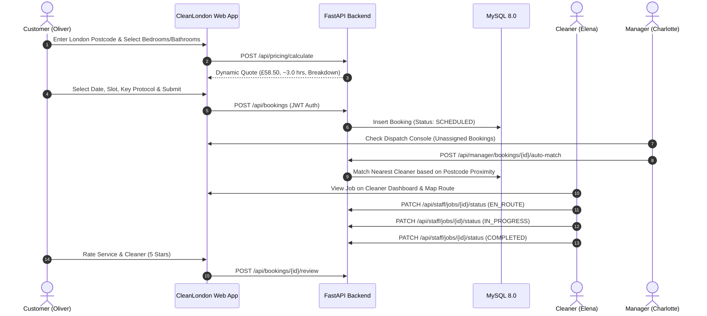
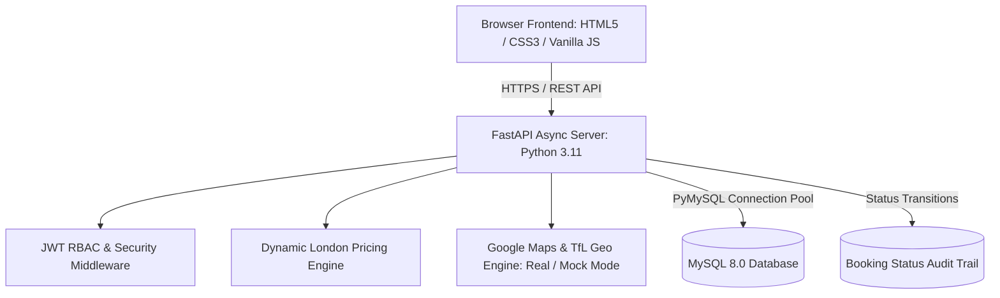

# CleanLondon Platform - Architecture, Specifications & Codebase Guide

CleanLondon is a high-trust, mobile-first domestic cleaning booking and dispatch platform tailored for the Greater London market. Built with **FastAPI**, **MySQL 8.0**, and **Docker Compose**, with a clean **HTML5/CSS3/Vanilla JS** responsive interface.

---

## 1. Product Requirements Document (PRD)

### 1.1 Executive Summary & Market Positioning
In London's fast-moving residential services market (pioneered by Housekeep and Fantastic Services), trust, punctuality, and price transparency are paramount. Homeowners and tenants demand instant dynamic pricing in GBP (£), vetted DBS-checked cleaning operatives, flexible key handover protocols, and real-time status visibility.

### 1.2 User Personas
1. **Oliver Smith (The Customer - Canary Wharf & Central London Tenant)**
   - *Demographics:* 32 years old, busy finance and tech professional living in a 2-bed flat.
   - *Needs:* Seamless booking in under 90 seconds, clear upfront price in £ without hidden fees, reliable key safe/concierge handover, and post-clean ratings.
   - *Pain Points:* Flaky cleaners arriving late, having to negotiate quotes over phone calls, and worrying about property security.

2. **Elena Petrova (The Staff / Cleaner - Southwark & Central London Operative)**
   - *Demographics:* 38 years old, 6 years domestic cleaning experience, DBS-verified.
   - *Needs:* Clear daily itinerary mapped along TfL transit corridors, clear instructions on key collection (concierge vs meet-in-person), and one-tap status updates (*Scheduled -> En Route -> In Progress -> Completed*).
   - *Pain Points:* Inaccurate addresses, ambiguous entry codes, and overlapping dispatch schedules.

3. **Charlotte Windsor (The Manager / Admin - Operations & Quality Lead)**
   - *Demographics:* 40 years old, manages territory dispatch and quality assurance across London zones.
   - *Needs:* Centralized command console with live KPIs (daily £ revenue, staff utilization %), automated postcode proximity dispatch, and review tracking.
   - *Pain Points:* Unassigned last-minute bookings and suboptimal travel times between disparate London outcodes.

### 1.3 Core Workflows


---

## 2. Technical Architecture Document (TAD)

### 2.1 System Architecture Overview


### 2.2 Tech Stack Rationale
- **FastAPI (Python 3.11):** High-performance async request handling, native Pydantic schema validation, and automatic OpenAPI documentation.
- **MySQL 8.0:** Relational integrity, foreign key cascading, ACID transactions for financial bookings, and full UTF8MB4 support.
- **HTML / CSS / Vanilla JavaScript:** Zero framework bloat, sub-50ms first contentful paint, universal browser compatibility, and direct DOM manipulation.
- **Docker Compose:** Isolated container networking (`cleanlondon_net`), healthchecks guaranteeing database readiness before API spinup, and persistent volumes.

### 2.3 API Routing Specification
| Method | Endpoint | Access Role | Description |
|---|---|---|---|
| `POST` | `/api/auth/register` | Public | Register customer or staff account |
| `POST` | `/api/auth/login` | Public | Authenticate with credentials, returns JWT |
| `POST` | `/api/auth/google/login` | Public | Prototype Google OAuth 2.0 with mock fallback |
| `POST` | `/api/auth/demo-switch` | Public | 1-click demo role switcher for evaluators |
| `GET` | `/api/services` | Public | List available cleaning service types |
| `POST` | `/api/pricing/calculate` | Public | Dynamic price quote in GBP (£) |
| `POST` | `/api/bookings` | Customer, Manager | Create domestic cleaning appointment |
| `GET` | `/api/bookings/my` | Customer | List authenticated customer bookings |
| `POST` | `/api/bookings/{id}/review` | Customer | Submit 1-5 star review for completed clean |
| `GET` | `/api/staff/jobs` | Staff | View assigned jobs for cleaner |
| `PATCH` | `/api/staff/jobs/{id}/status` | Staff, Manager | Advance sequential status (*SCHEDULED -> EN_ROUTE -> IN_PROGRESS -> COMPLETED*) |
| `GET` | `/api/manager/dashboard-stats` | Manager | Revenue in £, cleaner utilization %, booking counters |
| `GET` | `/api/manager/bookings` | Manager | All platform bookings with status filter |
| `POST` | `/api/manager/bookings/{id}/auto-match` | Manager | Haversine proximity-based auto cleaner match |
| `POST` | `/api/manager/bookings/{id}/assign` | Manager | Manually assign cleaner to booking |
| `POST` | `/api/maps/geocode` | Public | Postcode geocoding (Google Maps / centroid mock) |
| `POST` | `/api/maps/distance` | Public | Distance and TfL transit time calculation |

---

## 3. Privacy Policy & Security Architecture (UK GDPR)

### 3.1 UK GDPR & Data Protection Act 2018 Compliance
1. **Lawful Basis for Processing:** Processing of physical address data, key safe codes, and telephone numbers is strictly governed under *Contractual Necessity* (Article 6(1)(b) UK GDPR) to fulfill cleaning services.
2. **Access Control for Sensitive Property Data:** 
   - Full residential address and key handling instructions are **never exposed publicly**.
   - Cleaners only gain access to key instructions and address lines once the booking is assigned to their roster.
   - Key safe codes are concealed until the status transitions to `EN_ROUTE`.
3. **Data Retention & Right to Erasure (Article 17):** Access logs and customer phone records are retained for insurance purposes (6-year statute of limitations under English contract law) while physical access codes can be wiped immediately post-job.

### 3.2 Backend Security Controls
- **Password Protection:** Cryptographic hashing using `bcrypt` (work factor 12) with salted digests.
- **Stateless Role-Based JWT:** Cryptographically signed tokens using HMAC-SHA256 (`HS256`), carrying user ID, email, and explicit role (`customer`, `staff`, `manager`).
- **Endpoint Authorization Dependency:** `require_role(["manager"])` enforces strict route boundaries before database execution.
- **SQL Injection Prevention:** 100% parameterized queries via PyMySQL prepared statements.

---

## 4. Feature Tickets (User Stories with Gherkin Acceptance Criteria)

### Ticket 1: CL-101 - Customer Dynamic Quote & Postcode Estimation
- **As a** London resident,
- **I want to** enter my postcode and home size to receive an instant transparent quote in GBP (£),
- **So that** I know exactly what I will pay before booking.
```gherkin
Feature: Dynamic Cleaning Quote Calculation
  Scenario: Customer enters valid Central London postcode with pets
    Given the customer enters postcode "SW1A 1AA"
    And selects 2 bedrooms and 1 bathroom for "Regular Domestic Clean"
    And checks "I have indoor pets"
    When the customer triggers quote recalculation
    Then the system returns a total price of "£58.50"
    And displays estimated duration of "3.0 hours"
    And breaks down base service, room fees, pet fee (£10), and zone travel fee
```

### Ticket 2: CL-102 - Cleaner Sequential Job Status Progression
- **As a** field cleaner operative,
- **I want to** advance the status of my assigned cleaning job step-by-step,
- **So that** the customer and manager know my exact real-time progress.
```gherkin
Feature: Job Status Progression
  Scenario Outline: Valid status transition
    Given an assigned booking with status "<current_status>"
    When the cleaner updates the job status to "<new_status>"
    Then the booking status in the database is updated to "<new_status>"
    And an audit record is created in "booking_status_logs"
    Examples:
      | current_status | new_status  |
      | SCHEDULED      | EN_ROUTE    |
      | EN_ROUTE       | IN_PROGRESS |
      | IN_PROGRESS    | COMPLETED   |

  Scenario: Illegal status transition attempt
    Given an assigned booking with status "SCHEDULED"
    When the cleaner attempts to jump directly to "COMPLETED"
    Then the API rejects the request with HTTP 400 Bad Request
    And the booking status remains "SCHEDULED"
```

### Ticket 3: CL-103 - Manager Haversine Proximity Auto-Dispatch
- **As an** operations manager,
- **I want to** 1-click auto-match unassigned bookings to the nearest available cleaner,
- **So that** transit time across London is minimized and cleaners maintain optimal utilization.
```gherkin
Feature: Proximity Cleaner Matching
  Scenario: Dispatching an unassigned Camden booking
    Given an unassigned booking at "NW1 7JE" (Camden)
    And Cleaner "Marcus Sterling" is based in "NW1 4RY" (0.8 miles away, ★4.85)
    And Cleaner "Elena Petrova" is based in "SE1 7PB" (4.5 miles away, ★4.92)
    When the manager triggers "Auto-Match"
    Then the booking is assigned to "Marcus Sterling"
    And the manager UI updates the cleaner name and displays distance
```

### Ticket 4: CL-104 - Post-Clean Customer Review & Aggregate Rating
- **As a** customer who received a clean,
- **I want to** submit a 1 to 5-star review with comments,
- **So that** high-performing cleaners are rewarded and platform quality is verified.
```gherkin
Feature: Customer Review Submission
  Scenario: Reviewing a completed cleaning job
    Given a booking with status "COMPLETED" and no existing review
    When the customer submits a 5-star rating with text "Elena was punctual and thorough!"
    Then the review is stored in the "reviews" table
    And the cleaner's "rating_avg" and "rating_count" in "staff_profiles" are updated
```

---

## 5. Testing Plan

### 5.1 Unit & Integration Testing Matrix (Pytest)
1. **Auth & RBAC Matrix:**
   - Test password verification with valid/invalid inputs.
   - Validate token expiration and JWT signature tampering.
   - Verify that `customer` role receives HTTP 403 Forbidden on `/api/manager/*` endpoints.
2. **Pricing Engine Unit Tests:**
   - Test 1-bed/1-bath flat vs 4-bed/3-bath house.
   - Verify Central London congestion outcode surcharges (`SW1`, `EC1`, `W1`).
   - Validate pet fee and deep clean addon math.
3. **Status Machine Transition Tests:**
   - Ensure linear state progression (`SCHEDULED -> EN_ROUTE -> IN_PROGRESS -> COMPLETED`).
   - Block reverse or skipping transitions.

### 5.2 End-to-End (E2E) Flow (Playwright / Cypress)
1. **User registers/logs in as Customer (Oliver).**
2. **Fills out Quote form:** enters `SW1A 1AA`, 2 bedrooms, 1 bathroom.
3. **Submits booking:** fills in address, date, concierge key handover.
4. **Manager checks console:** clicks **Auto-Match** to assign the nearest cleaner (Elena).
5. **Staff switches view:** Elena marks job as **En Route**, then **In Progress**, then **Completed**.
6. **Customer reviews:** Oliver rates Elena 5 stars; aggregate rating updates immediately.

---

## 6. How to Run the Platform

### Option 1: Run with Docker Compose (Recommended)
```bash
# In the project directory:
docker-compose up --build
```
1. Open your browser to `http://localhost:8000`
2. MySQL 8.0 will initialize automatically from `init.sql` with full demo seed data.
3. The demo bar at the top lets you toggle between **Customer**, **Staff**, and **Manager** roles in one click.

### Local Stripe webhook forwarding

Stripe cannot call `localhost` directly. For real Stripe test payments, set
`STRIPE_CLI_API_KEY` in `.env`, start the application, and run:

```bash
docker compose --profile stripe up stripe-cli
```

The CLI prints a `whsec_...` signing secret. Copy it to `STRIPE_WEBHOOK_SECRET`
in `.env`, restart the backend, and complete a test Checkout. Payment status is
updated only by the signed `checkout.session.completed` webhook; the success
redirect is informational and is not treated as proof of payment.

### Option 2: Run Locally (Without Docker)
```bash
# 1. Install Python requirements
pip install -r requirements.txt

# 2. Configure .env with your local MySQL credentials
cp .env.example .env

# 3. Start the FastAPI server
uvicorn main:app --reload --port 8000
```
Open `http://127.0.0.1:8000` in your web browser.

### Default Seed Accounts (Demo Password for all: `Password123!`)
- **Manager (Admin):** `admin@cleanlondon.co.uk`
- **Staff (Elena Petrova):** `cleaner.elena@cleanlondon.co.uk`
- **Staff (Marcus Sterling):** `cleaner.marcus@cleanlondon.co.uk`
- **Customer (Oliver Smith):** `oliver.smith@example.co.uk`
- **Customer (Sophia Patel):** `sophia.patel@example.co.uk`
